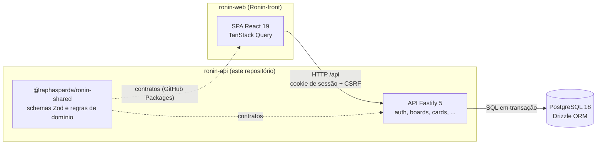

# Ronin API

**Backend auto-hospedado de quadros de tarefas para equipes pequenas.**

[](https://github.com/raphasparda/Ronin-End/actions/workflows/ci.yml)


> **English summary.** Ronin is a self-hosted, board-based task manager for small teams, in the spirit of Trello and ClickUp. This repository holds the REST API (Node 24, Fastify 5, PostgreSQL 18, Drizzle) and the shared Zod contracts package used by the [web client](https://github.com/raphasparda/Ronin-front). Highlights: Argon2id with httpOnly session cookies and CSRF checks, a race-free login throttle, fractional ordering with ordered row locks and concurrency tests, an append-only activity log enforced by a database trigger, and a zero-config local PostgreSQL for development. 795 automated tests. Documentation is in Brazilian Portuguese.

O Ronin é um app de tarefas em quadros, no estilo Trello e ClickUp, para uma equipe pequena rodar no próprio servidor, com backend e dados próprios. Este repositório tem a **API REST** e o pacote de **contratos compartilhados** com o front.

- Front-end (React + Vite): [raphasparda/Ronin-front](https://github.com/raphasparda/Ronin-front)

## Sumário

- [Destaques técnicos](#destaques-técnicos)
- [Arquitetura](#arquitetura)
- [Stack](#stack)
- [Como rodar](#como-rodar)
- [Scripts](#scripts)
- [Testes](#testes)
- [Estrutura do projeto](#estrutura-do-projeto)
- [Deploy](#deploy)
- [Documentação e API](#documentação-e-api)
- [Status e roadmap](#status-e-roadmap)
- [Autor](#autor)

## Destaques técnicos

Cada item aponta para o código ou o documento da decisão.

**Segurança e autenticação**

- **Senhas com Argon2id** (`@node-rs/argon2`) e **sessão em cookie `HttpOnly`**, com expiração ociosa e absoluta. Em produção, o cookie usa `Secure` e o prefixo `__Host-` ([`src/plugins/session.ts`](src/plugins/session.ts), [ADR 0002](docs/architecture/adr/0002-sessao-cookie-e-csrf.md), [ADR 0003](docs/architecture/adr/0003-argon2id-node-rs.md)).
- **CSRF por `Origin` + header próprio**: toda mutação exige `Origin` igual ao `APP_ORIGIN` e o header `X-Kanban-Csrf: 1` ([`src/plugins/csrf.ts`](src/plugins/csrf.ts)).
- **Bloqueio de login atômico, resistente a concorrência**: a tentativa é reservada num único `INSERT ... ON CONFLICT DO UPDATE ... RETURNING` antes do Argon2. Um teste dispara 30 logins paralelos com senha errada e confere que no máximo 5 chegam à verificação ([`src/modules/auth`](src/modules/auth)).
- **Links revogados quando um Admin perde o poder**: rebaixar, desativar ou anonimizar um Admin revoga, na mesma transação, os convites e links de redefinição pendentes criados por ele ([`src/modules/users/service.ts`](src/modules/users/service.ts)).
- **Configuração estrita para produção**: a API não sobe com `NODE_ENV=production` e `APP_ORIGIN` em `http://`, nem com `APP_ORIGIN` em `https://` fora de produção, nem em produção sem `SETUP_TOKEN` ([`src/config/env.ts`](src/config/env.ts)).
- **Setup inicial protegido por código**: com `SETUP_TOKEN`, a primeira conta Admin só é criada com o código certo, comparado em tempo constante antes de qualquer consulta ou hash ([`src/modules/setup`](src/modules/setup)).
- **Logs sem dados sensíveis**: cookies, `authorization`, senhas e tokens são omitidos, e erros de banco saem sem valores de parâmetros ([`src/logger.ts`](src/logger.ts)).
- **Anonimização de conta (LGPD)**: apaga e-mail e hash de senha de uma conta desativada e mantém cards, comentários e histórico como "Usuário removido". `CHECK`s no banco garantem o estado ([`docs/architecture/overview.md`](docs/architecture/overview.md)).

**Dados e concorrência**

- **Ordenação fracionária** (`fractional-indexing`): mover um card grava só a linha dele. Quando a chave passa de 64 caracteres, os irmãos são **rebalanceados em 2 etapas** (chaves temporárias, depois finais), sem violar o índice único ([`src/lib/ordering.ts`](src/lib/ordering.ts), [ADR 0004](docs/architecture/adr/0004-ordenacao-fractional-indexing.md)).
- **Locks em ordem fixa** (quadro → lista → card → checklist/comentário) para evitar deadlock, com **testes de concorrência** no PostgreSQL real: 20 movimentos simultâneos geram posições únicas; 10 conclusões simultâneas do mesmo card geram um único evento; duas aceitações simultâneas do mesmo convite criam uma só conta.
- **Histórico append-only**: a tabela de atividade dos cards recusa `UPDATE` e `DELETE` por trigger ([`drizzle/0004_card_activities_append_only.sql`](drizzle/0004_card_activities_append_only.sql)).

**Contratos e ambiente**

- **Contratos Zod compartilhados** entre API e web no pacote `@raphasparda/ronin-shared`, publicável no GitHub Packages por workflow (`publish-shared.yml`). As rotas validam entrada e resposta com esses schemas, que também geram o OpenAPI ([`packages/shared`](packages/shared), [ADR 0014](docs/architecture/adr/0014-dois-repositorios-e-shared-publicado.md)).
- **PostgreSQL de desenvolvimento sem configuração**: `pnpm dev` sobe um PostgreSQL 18 do próprio projeto (pacote `embedded-postgres`), sem Docker, sem admin e sem instalar nada no sistema ([`scripts/dev-db`](scripts/dev-db)).

## Arquitetura

Monólito modular: cada módulo de `src/modules` tem rotas, serviço e repositório. Em produção, SPA e API ficam na mesma origem, atrás do Caddy ([ADR 0009](docs/architecture/adr/0009-deploy-mesma-origem-caddy.md)).



Modelo de dados, segurança e deploy planejado: [`docs/architecture/overview.md`](docs/architecture/overview.md).

## Stack

| Camada       | Tecnologia                                                 |
| ------------ | ---------------------------------------------------------- |
| Runtime      | Node.js 24, TypeScript 5.9, pnpm 10 (workspace)            |
| HTTP         | Fastify 5, `fastify-type-provider-zod`, Helmet, rate limit |
| Banco        | PostgreSQL 18, Drizzle ORM, migrations SQL versionadas     |
| Contratos    | Zod 4 (`@raphasparda/ronin-shared`)                        |
| Autenticação | Argon2id (`@node-rs/argon2`), sessão em cookie             |
| Documentação | OpenAPI (`@fastify/swagger` + Swagger UI)                  |
| Testes       | Vitest 5 contra PostgreSQL real                            |
| Qualidade    | ESLint, Prettier, GitHub Actions                           |
| Build        | tsup                                                       |

## Como rodar

**Pré-requisitos:** Node.js 24 e pnpm 10 (`npm i -g pnpm@10`). Não precisa de Docker nem de PostgreSQL instalado. Os comandos funcionam no PowerShell (Windows), no Linux e no macOS.

1. Clone os dois repositórios lado a lado, com estes nomes de pasta (o web procura `../ronin-api`):

   ```powershell
   git clone https://github.com/raphasparda/Ronin-End.git ronin-api
   git clone https://github.com/raphasparda/Ronin-front.git ronin-web
   ```

2. Suba a API no primeiro terminal:

   ```powershell
   cd ronin-api
   pnpm install
   pnpm dev
   ```

   O `pnpm dev` cria o `.env` a partir do `.env.example`, sobe o PostgreSQL local na porta 5433 (dados em `.data/postgres`), aplica as migrations e inicia a API em watch na porta 3000. Confira em <http://127.0.0.1:3000/api/health>. **Ctrl+C** derruba tudo, inclusive o banco.

3. Suba o web no segundo terminal:

   ```powershell
   cd ronin-web
   pnpm install
   pnpm dev
   ```

4. Abra <http://127.0.0.1:5310>. Com o banco vazio, a primeira tela é **Configurar a equipe**: a primeira conta vira Admin.

Instale o ronin-api antes do ronin-web: o web usa o pacote de contratos direto desta pasta (`link:../ronin-api/packages/shared`).

<details>
<summary><strong>Primeiro uso: convites e redefinição de senha</strong></summary>

**Convidar pessoas**

1. No cabeçalho, abra **Administração** → aba **Convites** → **Novo convite**.
2. Informe o e-mail (opcional; se preencher, só esse e-mail usa o convite) e o papel.
3. Clique em **Criar convite** e copie o **Link do convite**. Ele aparece uma única vez e vale 7 dias.
4. Envie o link por um canal privado. A pessoa abre o link, informa nome, e-mail e senha e já entra logada.

Para testar sozinho, abra o link numa janela anônima: aceitar o convite na janela do Admin troca a sessão para a conta nova.

**Redefinir a senha de alguém (sem e-mail)**

1. **Administração** → aba **Membros**.
2. No menu de ações da pessoa, clique em **Gerar link de redefinição de senha**.
3. Envie o link por um canal privado. Ele vale 24 h, é de uso único e encerra as sessões antigas da pessoa.

</details>

<details>
<summary><strong>Alternativas de banco: Docker ou PostgreSQL nativo</strong></summary>

**Docker**

```powershell
pnpm db:up     # sobe postgres:18-alpine na porta POSTGRES_PORT (5433 no .env.example)
pnpm db:down   # para e remove o container (os dados ficam no volume)
```

Não rode junto com o banco local: os dois usam a 5433. Com o container de pé, o `pnpm dev` detecta e reaproveita. O banco `kanban_test` é criado por `infra/postgres/init/01-test-db.sql` só na primeira subida do volume.

**PostgreSQL nativo**

Exige a senha do superusuário `postgres`. Com o PostgreSQL 18 na porta 5432, rode uma vez na raiz do repositório (PowerShell):

```powershell
& "C:\Program Files\PostgreSQL\18\bin\psql.exe" -h 127.0.0.1 -U postgres -d postgres -f infra/postgres/local-setup.sql
```

No Linux ou macOS, use o `psql` do `PATH` com os mesmos argumentos. O script é idempotente: cria o role `kanban` (senha `kanban`, só para desenvolvimento) e os bancos `kanban` e `kanban_test`. Depois, troque a porta para **5432** em `DATABASE_URL` e `TEST_DATABASE_URL` no `.env`.

</details>

Portas, problemas comuns e como zerar o banco: [`docs/ops/setup-local.md`](docs/ops/setup-local.md).

## Scripts

Rode na raiz do repositório.

| Comando                             | O que faz                                                                  |
| ----------------------------------- | -------------------------------------------------------------------------- |
| `pnpm dev`                          | banco local (5433), migrations e API em watch (3000)                       |
| `pnpm dev:api`                      | só a API em watch (banco por sua conta)                                    |
| `pnpm db:dev`                       | só o banco local, em primeiro plano (Ctrl+C para parar)                    |
| `pnpm db:migrate`                   | aplica as migrations pendentes em `DATABASE_URL` (idempotente)             |
| `pnpm db:generate`                  | gera migration a partir do schema (drizzle-kit)                            |
| `pnpm db:up` / `pnpm db:down`       | sobe/derruba o PostgreSQL do `docker-compose.yml`                          |
| `pnpm test`                         | testes do shared (com cobertura) e da API (sobe o banco local se precisar) |
| `pnpm test:api`                     | só os testes da API                                                        |
| `pnpm lint` / `pnpm lint:fix`       | ESLint                                                                     |
| `pnpm typecheck`                    | TypeScript da API e do shared                                              |
| `pnpm format` / `pnpm format:check` | Prettier                                                                   |
| `pnpm build`                        | `dist/` do shared (ESM + `.d.ts`), `dist/server.js` e `dist/migrate.js`    |
| `pnpm start`                        | roda o build da API                                                        |
| `pnpm start:prod`                   | produção: aplica as migrations (`dist/migrate.js`) e sobe a API            |
| `pnpm shared:pack`                  | gera o tarball publicável do `@raphasparda/ronin-shared`                   |

## Testes

```powershell
pnpm test
```

Última execução local (17/09/2026), todos passando:

| Suíte                       | Arquivos | Testes  | Observação                                                 |
| --------------------------- | -------- | ------- | ---------------------------------------------------------- |
| `@raphasparda/ronin-shared` | 17       | 352     | schemas e regras de domínio; cobertura de 100% das linhas  |
| API                         | 46       | 443     | integração com `app.inject` e PostgreSQL real, e unitários |
| **Total**                   | **63**   | **795** |                                                            |

- O mínimo de cobertura exigido no shared é 95% em `domain/`.
- As rotas são testadas para sucesso, 401, CSRF, validação, 404, permissões e conflitos (409), além das regras de negócio e dos cenários de concorrência.
- O setup global do Vitest ([`test/global-setup.ts`](test/global-setup.ts)) sobe o PostgreSQL local se ele não estiver rodando e aplica as migrations no banco `kanban_test`. Os testes de banco truncam as tabelas antes de cada caso.
- Os testes de banco leem `TEST_DATABASE_URL` do `.env`, criado pelo `pnpm dev`. Num clone novo, rode `pnpm dev` uma vez ou copie o `.env.example` para `.env`: sem a variável, esses testes são pulados.
- Os testes E2E (Playwright + axe) ficam no [ronin-web](https://github.com/raphasparda/Ronin-front) e sobem esta API numa porta própria.

CI no GitHub Actions: lint, typecheck, testes com PostgreSQL de serviço, build e verificação do pacote ([`docs/ops/ci.md`](docs/ops/ci.md)).

## Estrutura do projeto

```text
src/
  modules/         um módulo por área: auth, boards, lists, cards, checklists, comments, ...
  plugins/         sessão, CSRF, erros, headers de segurança, rate limit, OpenAPI
  db/              schema Drizzle, cliente e migrador
  lib/             ordenação fracionária, datas, tokens, senhas
  config/          leitura e validação do ambiente
test/              setup global do Vitest, helpers de app, login e fixtures
drizzle/           migrations SQL geradas e revisadas
packages/shared/   @raphasparda/ronin-shared: schemas Zod e regras de domínio
scripts/           pnpm dev, PostgreSQL local e renomeação do pacote shared
infra/postgres/    SQL das alternativas Docker e PostgreSQL nativo
docs/              produto, arquitetura (ADRs) e operação
```

## Deploy

O caminho de baixo custo é o **Render** (Web Service Free para a API, Static Site para o front com rewrite de `/api/*`, mesma origem) com PostgreSQL no **Neon**. O [`render.yaml`](render.yaml) documenta o serviço da API; o passo a passo, as variáveis, o `SETUP_TOKEN` do primeiro acesso e os limites do plano gratuito estão em [`docs/ops/deploy-render.md`](docs/ops/deploy-render.md).

Resumo: build `corepack enable && pnpm install --frozen-lockfile && pnpm build`, start `pnpm start:prod` (migrations e servidor), health check `/api/health`. Em produção a API não sobe sem `APP_ORIGIN` em `https://` e sem `SETUP_TOKEN`.

## Documentação e API

Com a API rodando em desenvolvimento, a documentação **OpenAPI interativa** fica em <http://127.0.0.1:3000/api/docs>. Em produção ela fica desligada.

| Documento                                                        | Conteúdo                                                    |
| ---------------------------------------------------------------- | ----------------------------------------------------------- |
| [`docs/product/scope.md`](docs/product/scope.md)                 | escopo do MVP, histórias, regras de negócio, fora de escopo |
| [`docs/architecture/overview.md`](docs/architecture/overview.md) | arquitetura, modelo de dados, segurança, deploy planejado   |
| [`docs/architecture/api.md`](docs/architecture/api.md)           | contrato da API REST e decisões de implementação            |
| [`docs/architecture/plan.md`](docs/architecture/plan.md)         | plano de implementação por fatias                           |
| [`docs/architecture/adr/`](docs/architecture/adr/)               | decisões de arquitetura (ADRs)                              |
| [`docs/ops/setup-local.md`](docs/ops/setup-local.md)             | ambiente local em detalhe e problemas comuns                |
| [`docs/ops/ci.md`](docs/ops/ci.md)                               | pipelines do GitHub Actions                                 |
| [`docs/ops/deploy-render.md`](docs/ops/deploy-render.md)         | deploy no Render (plano Free) com PostgreSQL no Neon        |
| [`docs/ops/shared-package.md`](docs/ops/shared-package.md)       | build, publicação e consumo do `@raphasparda/ronin-shared`  |
| [`docs/ops/known-issues.md`](docs/ops/known-issues.md)           | problemas conhecidos e pendências do deploy                 |
| [`CHANGELOG.md`](CHANGELOG.md)                                   | histórico de entregas                                       |

Design (cores, tokens e telas) fica no ronin-web, em `docs/design/`.

## Status e roadmap

- **Fatias 0 a 9 do MVP: implementadas.** Equipe e acesso, quadros e listas coloridas, cards com responsáveis, etiquetas, prazo e prioridade, checklists, comentários, notificações, Meus cards e anonimização.
- **Fatia 10, produção em VPS: pendente.** Imagem Docker da API, Caddy com HTTPS automático e headers de segurança, banco sem porta publicada, backup fora da VPS com restauração testada e volta após reboot ([`plan.md`](docs/architecture/plan.md)).
- Ainda não exponha esta versão na internet: os bloqueios do deploy e a decisão pendente sobre o bloqueio de login por e-mail estão em [`docs/ops/known-issues.md`](docs/ops/known-issues.md).

## Autor

**Raphael Sparda** · SPARDA.dev · [github.com/raphasparda](https://github.com/raphasparda)
