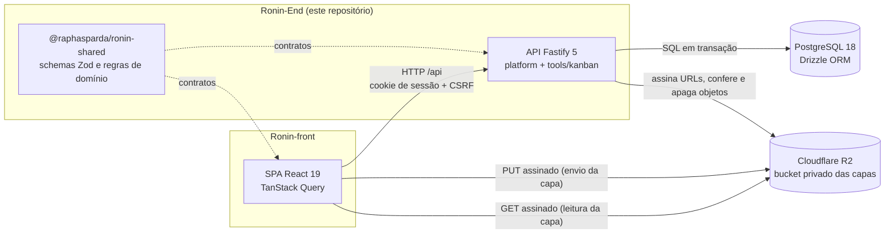

<p align="center">
  
</p>

<h1 align="center">Ronin API</h1>

<p align="center"><strong>Backend do Ronin, um hub de ferramentas para equipes pequenas de software, com dados no seu próprio servidor. A primeira ferramenta é um Kanban.</strong></p>

<p align="center">
  <a href="https://github.com/raphasparda/Ronin-End/actions/workflows/ci.yml"></a>
  
  
  
</p>

<p align="center">
  
  
  
  
  
  
  
  
  
  
</p>

> **English summary.** Ronin is a self-hosted tool hub for small software teams; its first tool is a Kanban board. This repository holds the REST API (Node 24, Fastify 5, PostgreSQL 18, Drizzle) and the shared Zod contracts package used by the [web client](https://github.com/raphasparda/Ronin-front). Highlights: Argon2id with HttpOnly session cookies and CSRF checks, a race-free login throttle, restricted boards enforced server-side inside the same row locks every mutation already takes, board covers stored in a private Cloudflare R2 bucket with browser-to-storage uploads and short-lived signed reads (SigV4 written by hand, no SDK), fractional ordering with ordered row locks and concurrency tests, an append-only activity log enforced by a database trigger, and 906 automated tests against a real PostgreSQL. The code is split into a platform layer and per-tool modules.

O Ronin nasceu de um problema concreto: ferramentas SaaS de quadros guardam os dados de terceiros e carregam funções que uma equipe de cinco pessoas nunca usa. Este repositório tem a **API REST** e o pacote de **contratos compartilhados** com o front, organizados em plataforma (equipe, acesso, notificações) e ferramentas, começando pelo **Kanban**.

- Front-end (React + Vite): [raphasparda/Ronin-front](https://github.com/raphasparda/Ronin-front)

## Sumário

- [Destaques técnicos](#-destaques-técnicos)
- [Arquitetura](#-arquitetura)
- [Stack](#-stack)
- [Qualidade](#-qualidade)
- [Documentação](#-documentação)
- [Roadmap](#-roadmap)
- [Autor](#-autor)

## 🔩 Destaques técnicos

Cada item aponta para o código ou para o documento da decisão.

**Segurança e autenticação**

- **Senhas com Argon2id e sessão em cookie `HttpOnly`**, com expiração ociosa e absoluta. Em produção, o cookie usa `Secure` e o prefixo `__Host-`. [session.ts](src/plugins/session.ts) · [ADR 0002](docs/architecture/adr/0002-sessao-cookie-e-csrf.md) · [ADR 0003](docs/architecture/adr/0003-argon2id-node-rs.md)
- **CSRF por `Origin` mais header próprio.** Toda mutação exige `Origin` igual ao `APP_ORIGIN` e o header `X-Ronin-Csrf: 1`. [csrf.ts](src/plugins/csrf.ts)
- **Bloqueio de login atômico, resistente a concorrência.** A tentativa é reservada num único `INSERT ... ON CONFLICT ... RETURNING` antes do Argon2. Um teste dispara 30 logins paralelos com senha errada e confere que no máximo 5 chegam à verificação. [auth/](src/modules/platform/auth)
- **Links revogados quando um Admin perde o poder.** Rebaixar, desativar ou anonimizar um Admin revoga, na mesma transação, os convites e links de redefinição pendentes criados por ele. [users/service.ts](src/modules/platform/users/service.ts)
- **Configuração estrita para produção.** A API não sobe com `NODE_ENV=production` e `APP_ORIGIN` em `http://`, nem sem `SETUP_TOKEN`, nem com parte das variáveis do R2. [env.ts](src/config/env.ts)
- **Setup inicial protegido por código**, comparado em tempo constante antes de qualquer consulta ou hash. [setup/](src/modules/platform/setup)
- **Logs sem dados sensíveis.** Cookies, `authorization`, senhas, tokens e o segredo do R2 são omitidos, e erros de banco saem sem valores de parâmetros. [logger.ts](src/logger.ts)
- **Anonimização de conta (LGPD).** Apaga e-mail e hash de senha de uma conta desativada e mantém cards, comentários e histórico como "Usuário removido", com `CHECK`s no banco garantindo o estado.

**Quadros restritos e capa**

- **Uma função decide o acesso ao quadro, e ela roda dentro do lock.** A checagem é aplicada sobre a linha já bloqueada, depois do 404 e antes de qualquer 409: restringir o quadro em paralelo não deixa passar mutação. Vale para listas, cards, comentários, checklists, etiquetas, responsáveis, atividade e capa. [boards/access.ts](src/modules/tools/kanban/boards/access.ts) · [ADR 0015](docs/architecture/adr/0015-visibilidade-do-quadro-e-listagem-bloqueada.md)
- **Quadro bloqueado é um tipo próprio.** A listagem devolve uma união discriminada: quem não tem acesso recebe só `{ id, name, locked: true }`, e o serializer corta qualquer campo extra. [schemas/boards.ts](packages/shared/src/tools/kanban/schemas/boards.ts)
- **Onde o card é "meu trabalho", o corte é filtro e não erro.** Meus cards, notificações e o contador de não lidas omitem cards de quadros sem acesso. Nada é apagado: recuperar o acesso traz tudo de volta.
- **Capa enviada do navegador direto para o Cloudflare R2**, em três passos: a API assina um `PUT` curto, o navegador manda os bytes e a API confirma com `HEAD` mais os 16 primeiros bytes do objeto, para validar o formato antes de gravar. [boards/cover.ts](src/modules/tools/kanban/boards/cover.ts) · [ADR 0016](docs/architecture/adr/0016-capas-no-cloudflare-r2-com-urls-assinadas.md)
- **Leitura por URL assinada com vencimento em janelas de 5 minutos.** A mesma string vale por 5 minutos seguidos, então o polling não invalida o cache do navegador. Assinar é HMAC local, sem rede.
- **Cliente do R2 escrito à mão**, SigV4 com `node:crypto` e `fetch`, sem SDK e sem dependência nova. Falha de rede vira `503`, nunca `500`. [r2.ts](src/lib/r2.ts)
- **Recurso opcional e tudo ou nada.** Sem as variáveis do R2, a capa some do app e o resto não muda. A manutenção diária recolhe objetos órfãos. [maintenance.ts](src/plugins/maintenance.ts)

**Dados e concorrência**

- **Ordenação fracionária.** Mover um card grava só a linha dele. Quando a chave cresce demais, os irmãos são rebalanceados em duas etapas, sem violar o índice único. [ordering.ts](src/lib/ordering.ts) · [ADR 0004](docs/architecture/adr/0004-ordenacao-fractional-indexing.md)
- **Locks em ordem fixa** para evitar deadlock, com testes de concorrência no PostgreSQL real: 20 movimentos simultâneos geram posições únicas, 10 conclusões simultâneas do mesmo card geram um único evento, e duas aceitações do mesmo convite criam uma só conta.
- **Histórico append-only.** A tabela de atividade recusa `UPDATE` e `DELETE` por trigger, não por convenção. [migration 0004](drizzle/0004_card_activities_append_only.sql)
- **Payload do quadro em 6 consultas**, com a capa no mesmo `LEFT JOIN`. Um teste garante o número.

**Contratos e ambiente**

- **Um schema, três usos.** Os contratos Zod validam a entrada, serializam a saída e geram a OpenAPI. API e front não divergem. [packages/shared](packages/shared) · [ADR 0014](docs/architecture/adr/0014-dois-repositorios-e-shared-publicado.md)
- **PostgreSQL de desenvolvimento sem configuração**, subido pelo próprio projeto, sem Docker e sem instalar nada no sistema. [scripts/dev-db](scripts/dev-db)

## 🧭 Arquitetura

Monólito modular. O código separa o que **toda ferramenta usa** do que é **de uma ferramenta**, e cada ferramenta entra na API por um único registrador.

```text
src/modules/
  platform/        setup, auth, sessões, convites, membros, perfil, admin, notificações
  tools/kanban/    quadros, listas, cards, etiquetas, checklists, comentários, atividade, conclusão
                   index.ts exporta registerKanbanTool(app)
src/plugins/       sessão, CSRF, erros, headers de segurança, rate limit, manutenção, OpenAPI
src/db/            schema Drizzle, cliente e migrador
packages/shared/   contratos Zod e regras puras: platform/ e tools/kanban/
```



Em produção, SPA e API ficam na mesma origem: Web Service no Render para a API, PostgreSQL no Neon, capas no Cloudflare R2, e o front com rewrite de `/api/*`. Modelo de dados, segurança e variáveis: [overview.md](docs/architecture/overview.md).

## 🧱 Stack

| Camada        | Tecnologia                                                         |
| ------------- | ------------------------------------------------------------------ |
| Runtime       | Node.js 24, TypeScript 5.9 em modo `strict`, pnpm 10 workspace     |
| HTTP          | Fastify 5, Zod 4 com type provider, Helmet, rate limit             |
| Banco         | PostgreSQL 18, Drizzle ORM, migrations SQL versionadas             |
| Contratos     | Zod 4 no pacote `@raphasparda/ronin-shared`                        |
| Autenticação  | Argon2id (`@node-rs/argon2`), sessão em cookie                     |
| Armazenamento | Cloudflare R2 em bucket privado, SigV4 próprio com `node:crypto`   |
| Documentação  | OpenAPI gerada dos schemas, Swagger UI fora de produção            |
| Testes        | Vitest 5 contra PostgreSQL real, R2 falso em memória               |
| Qualidade     | ESLint (typescript-eslint, type-checked), Prettier, GitHub Actions |
| Publicação    | Render Web Service, Neon, build com tsup                           |

## ✅ Qualidade

Medido em 18/09/2026:

| Suíte                                            | Testes | Resultado                                |
| ------------------------------------------------ | -----: | ---------------------------------------- |
| `@raphasparda/ronin-shared` (regras e contratos) |    387 | ✅ 100% das linhas de `domain/` cobertas |
| API (integração com PostgreSQL real e unitários) |    519 | ✅                                       |

As rotas são testadas para sucesso, 401, CSRF, validação, 404, permissões e conflitos, além das regras de negócio e dos cenários de concorrência. A matriz de acesso do quadro restrito cobre quadro, listas, cards, comentários, checklists, etiquetas, responsáveis e atividade. Os testes de capa usam um R2 falso em memória e não falam com a rede. A CI roda lint, typecheck, as duas suítes com PostgreSQL de serviço, build e a verificação do pacote publicável, a cada pull request. Os E2E com Playwright ficam no [Ronin-front](https://github.com/raphasparda/Ronin-front) e sobem esta API numa porta própria.

## 📚 Documentação

| Documento                                                      | Conteúdo                                                       |
| -------------------------------------------------------------- | -------------------------------------------------------------- |
| [docs/product/scope.md](docs/product/scope.md)                 | escopo do MVP e da Fatia 11, histórias, regras, fora de escopo |
| [docs/architecture/overview.md](docs/architecture/overview.md) | arquitetura, modelo de dados, segurança, variáveis, deploy     |
| [docs/architecture/api.md](docs/architecture/api.md)           | contrato da API REST e decisões de implementação               |
| [docs/architecture/adr/](docs/architecture/adr/)               | decisões de arquitetura registradas, da 0001 à 0016            |
| [docs/ops/setup-local.md](docs/ops/setup-local.md)             | ambiente de desenvolvimento, para quem for contribuir          |
| [docs/ops/deploy-render.md](docs/ops/deploy-render.md)         | publicação no Render com PostgreSQL no Neon                    |
| [docs/ops/shared-package.md](docs/ops/shared-package.md)       | build, publicação e consumo do pacote de contratos             |
| [docs/ops/known-issues.md](docs/ops/known-issues.md)           | problemas conhecidos e pendências                              |
| [CHANGELOG.md](CHANGELOG.md)                                   | histórico de versões                                           |

## 🗺️ Roadmap

- **1.0.0:** produção em servidor próprio com Docker, Caddy com HTTPS, banco sem porta publicada e backup criptografado fora da VPS.
- **Hub:** registro de ferramentas, notificações e histórico genéricos por ferramenta, tabelas com dono por ferramenta.
- **Decisão pendente:** o bloqueio de login por e-mail pode ser usado para manter uma conta fora do ar. As opções estão em [known-issues.md](docs/ops/known-issues.md).
- **Próximas ferramentas** entram em `modules/tools/<nome>` sem tocar na plataforma.

## 👤 Autor

**Raphael Sparda** · SPARDA.dev · [github.com/raphasparda](https://github.com/raphasparda)
