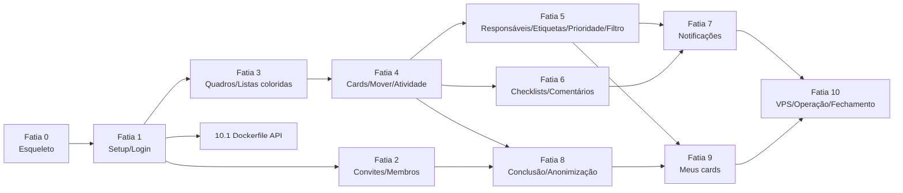

# Kanban: plano de implementação do MVP

> Status: v1.2 (2026-09-16). Base: `overview.md`, `api.md`, `adr/`, `docs/product/scope.md` v2.
> v1.2: gamificação removida; cor por lista, prioridade do card e reabrir para o topo incluídos; Fatia 8 virou "Conclusão e anonimização"; Fatia 10 cobre operação em VPS (banco fechado, backup fora da VPS, reboot).
> Cada fatia é vertical (banco → API → UI → testes) e termina com algo utilizável. Tarefas pequenas (≤ 1 dia), ordenadas, com área, dependências e critério de pronto (DoD).

## Regras gerais (valem para todas as tarefas)

- **Contrato primeiro:** a tarefa `Shared` de cada fatia implementa os schemas Zod exatamente como em `api.md`. Com ela pronta, backend e frontend rodam em paralelo (o front usa MSW com os mesmos schemas).
- **DoD comum** (além do específico): `pnpm lint`, `pnpm typecheck` e `pnpm test` verdes; sem `any` implícito; sem `console.log`; mensagens de UI em pt-BR; nenhuma resposta de API fora do schema; migrations geradas por `drizzle-kit generate` e SQL revisado/commitado; `api.md`/`overview.md` atualizados se algo mudou.
- **Toda rota nova** tem testes de integração (`app.inject`) cobrindo: sucesso, 401, CSRF, validação, 404, permissões e os 409 da rota (api.md §17). Esses testes são do o backend na própria tarefa; o o QA cobre regras cruzadas, E2E e revisão de lacunas.
- **Toda tela nova**: navegável por teclado, foco visível, rótulos em ícones, estados de carregando/vazio/erro, funciona em 360 px de largura, usa só tokens de `globals.css` (sem cores literais), e nenhuma informação só por cor (RN17).
- Áreas: Banco (DB), Backend (BE), Frontend (FE), Infra (OPS), QA (QA) e Segurança (SEC, revisão final). O design fornece a paleta final e revisa telas.

---

## Fatia 0: Esqueleto do monorepo, docker-compose e shared

Objetivo: `git clone` → `pnpm install` → `pnpm db:up` → `pnpm dev` abre a SPA que consulta `/api/health` com sucesso, no Windows.

| ID | Área | Depende | Tarefa | DoD |
|----|--------|---------|--------|-----|
| 0.1 | OPS | — | Raiz do monorepo: `package.json` (scripts de `overview.md` §3, `packageManager: pnpm@10`), `pnpm-workspace.yaml`, `tsconfig.base.json` (`strict`, `noUncheckedIndexedAccess`, `moduleResolution: bundler`), ESLint flat + Prettier, `.editorconfig`, `.gitattributes` (`* text=auto eol=lf`), `.nvmrc` (24), `.gitignore`, `.env.example` (tabela de `overview.md` §3), README curto de dev. | `pnpm install` e `pnpm lint` passam no Windows (PowerShell) e no Linux. |
| 0.2 | OPS | 0.1 | `docker-compose.yml` de dev com `postgres:18-alpine` (usuário/senha/db `kanban`, porta `${POSTGRES_PORT:-5432}` ligada só em `127.0.0.1`, volume nomeado em `/var/lib/postgresql`, healthcheck `pg_isready`) e `infra/postgres/init/01-test-db.sql` criando `kanban_test`. Scripts `db:up`/`db:down`. | `pnpm db:up` sobe saudável; `psql` conecta em `kanban` e `kanban_test`. |
| 0.3 | BE | 0.1 | `packages/shared`: `package.json` (`exports` para `src/index.ts`), `errors.ts` (union `ErrorCode` completa de api.md §3 + `errorResponseSchema`), `schemas/common.ts` (`uuidSchema`, `isoDateTimeSchema`, `placementSchema`, `dueInputSchema`, `emailSchema`, `passwordSchema`, `paletteColorSchema`, `cardPrioritySchema`), `domain/due-state.ts` (`getDueState`), `domain/palette.ts` (`PALETTE`, `nextPaletteColor(lastColor \| null)`), `domain/priority.ts` (`PRIORITY_RANK`, `comparePriority`, rótulos pt-BR), com testes unitários. | Testes: due-state nos limites de 24h, sem hora, concluído; `nextPaletteColor` cíclico e com `null`; ordem Urgente > Alta > Média > Baixa > sem prioridade. Cobertura ≥ 95% em `domain/`. |
| 0.4 | BE | 0.1, 0.3 | `apps/api`: `buildApp()` com Fastify 5, `config/env.ts` (Zod, `process.loadEnvFile`), type provider Zod (validator + serializer), `plugins/errors.ts` (envelope, mapeamento Zod/23505/404/500), logger pino com `redact`, `lib/app-error.ts`, decorator `clock`, `GET /api/health` (503 sem banco), OpenAPI em `/api/docs` fora de produção. `server.ts` e script `dev` (tsx watch). | `GET /api/health` 200 com banco e 503 sem; erro de validação volta no envelope; testes com `inject` para os três casos. |
| 0.5 | DB | 0.2, 0.4 | Drizzle: `drizzle.config.ts`, `db/client.ts` (Pool `pg`, `max` por env, padrão 10), `db/types.ts` (customType `textC` → `text COLLATE "C"`), `db/migrate.ts`, scripts `db:generate`/`db:migrate`. Infra de teste da API: `vitest.config.ts` com `globalSetup` (migrate em `TEST_DATABASE_URL`), `fileParallelism: false`, helper `truncateAll()`. | `pnpm db:migrate` idempotente; teste de exemplo roda contra `kanban_test` e trunca entre testes. |
| 0.6 | FE | 0.1, 0.3 | `apps/web`: Vite + React 19 + TS, Tailwind 4, `styles/globals.css` com tokens semânticos para tema claro (padrão) e escuro, e tokens-base `--palette-<cor>-bg|fg|border` e `--priority-<nivel>-bg|fg` (valores provisórios com contraste AA, `overview.md` §9); fontes via `@fontsource`; `lib/api-client.ts` (fetch `credentials: 'same-origin'`, header `X-Kanban-Csrf: 1`, JSON, lança `ApiError` tipado com `ErrorCode`); `lib/query-client.ts` com tratamento global (401/403/429/5xx); `router.tsx` com layout e página placeholder; `AppHeader` com slide de tema (`role="switch"`, `localStorage`, `/theme-init.js` sem flash); componentes base `Button`, `Input`, `Toast`, `ColorSwatch`, `PriorityBadge`; Vite proxy `/api`; Vitest + Testing Library + MSW configurados. | `pnpm dev` abre a página que mostra status do health; tema alterna e persiste sem flash; teste do `api-client` e do switch passando; página interna `/dev/paleta` (só em dev) exibe todas as cores e prioridades nos dois temas para revisão do designer. |
| 0.7 | OPS | 0.4, 0.5, 0.6 | CI GitHub Actions: `ubuntu-latest`, Node 24, pnpm cache, serviço `postgres:18-alpine`, passos install → lint → typecheck → test → build. | PR de teste mostra pipeline verde; falha de lint quebra o job. |
| 0.8 | QA | 0.6, 0.7 | Playwright em `apps/web/e2e` (`webServer` sobe API + web), `@axe-core/playwright`, smoke test (app carrega, health ok, axe sem violações sérias nos dois temas, incluindo `/dev/paleta`); passo `test:e2e` no CI com upload de trace em falha. | Smoke verde local (Windows) e no CI. |

Paralelismo: 0.2 e 0.3 após 0.1 em paralelo; 0.4 e 0.6 em paralelo após 0.3; 0.5 após 0.4.

---

## Fatia 1: Setup inicial, login, logout e sessão (A1, A3)

| ID | Área | Depende | Tarefa | DoD |
|----|--------|---------|--------|-----|
| 1.1 | BE | 0.3 | Shared: `schemas/auth.ts` (setup, login, `sessionUserSchema`, `workspaceSchema`, respostas de `/setup/*` e `/auth/login\|logout\|me`). | Schemas batem com api.md §4–5; testes de normalização de e-mail e limites de senha. |
| 1.2 | DB | 0.5 | Tabelas `workspace`, `users`, `sessions`, `auth_throttle` com enums, `CHECK`s e índices de `overview.md` §5.1. | Migration aplicada em base limpa; `CHECK (id=1)` e `UNIQUE(email)` testados. |
| 1.3 | BE | 1.1, 1.2 | `lib/password.ts` (Argon2id, parâmetros de teste), `lib/tokens.ts`, `plugins/session.ts` (cookie, lookup, sliding expiry, `request.user`, `preHandler` global com `config.public`, `requireAdmin`), `plugins/csrf.ts`. | Testes: sessão expirada (ociosa e absoluta) → 401 e cookie limpo; usuário desativado → 401; mutação sem header/Origin → 403 `CSRF_REJECTED`; rota pública acessível sem sessão; cookie `__Host-`/`Secure` em `NODE_ENV=production`. |
| 1.4 | BE | 1.3 | Módulo `setup`: `GET /api/setup/status`, `POST /api/setup` (advisory lock, rate limit). | Duas chamadas concorrentes de setup → só uma cria (a outra 409). |
| 1.5 | BE | 1.3 | Módulo `auth`: login (hash fictício, throttle por e-mail 5 / IP 20 persistido, `Retry-After`), logout, `GET /api/auth/me`; `plugins/rate-limit.ts` (geral 600/min). | Testes: resposta idêntica para e-mail inexistente e senha errada; 6ª tentativa → 429; sucesso zera contador do e-mail; logout invalida no servidor (cookie antigo → 401); nova sessão a cada login. |
| 1.6 | FE | 1.1, 0.6 | Boot (`setup/status` → `/setup`; `auth/me` → `/login`), `RequireAuth`, página `/setup` (nome do workspace, nome, e-mail, senha + confirmação, fuso com padrão), `/login` (`?next=`), menu do usuário no header com "Sair". Formulários mapeiam `details` de validação. | Testes com MSW: redirecionamentos de boot; erro genérico de login; 429 mostra tempo de espera; logout volta ao login. |
| 1.7 | QA | 1.4, 1.5, 1.6 | E2E: instância limpa → setup → home logado → logout → login errado (mensagem genérica) → login certo. Teste de API: setup some após primeiro usuário. | E2E verde no CI; A1/A3 marcados. |

---

## Fatia 2: Convites, membros, redefinição de senha e perfil (A2, A4, A5, A6)

| ID | Área | Depende | Tarefa | DoD |
|----|--------|---------|--------|-----|
| 2.1 | BE | 1.1 | Shared: `schemas/users.ts` (`userSummarySchema`, admin user), `schemas/admin.ts` (convites, reset links, workspace), `schemas/me.ts` (perfil, senha), respostas de `/auth/invites/*` e `/auth/password-resets/*`. | Batem com api.md §5–8. `userSummarySchema` não tem e-mail. |
| 2.2 | DB | 1.2 | Tabela `auth_tokens` com `CHECK`s (convite exige `role`; reset exige `target_user_id`) e índice único em `token_hash`. | Migration ok; `CHECK`s testados. |
| 2.3 | BE | 2.1, 2.2, 1.5 | Convites: `GET/POST/DELETE /api/admin/invites`, `POST /api/auth/invites/lookup\|accept` (consumo atômico, e-mail fixo, login automático, rate limit). | Testes: token expirado/usado/revogado → 410; duas aceitações concorrentes → uma 201, outra 410; e-mail existente → 409 sem consumir token; Member → 403 nas rotas admin; banco nunca contém o token em claro. |
| 2.4 | BE | 2.3 | Membros: `GET /api/users`, `GET/PATCH /api/admin/users`, `deactivate`, `reactivate`, `password-reset-links`; `POST /api/auth/password-resets/lookup\|complete`; `PATCH /api/me`, `POST /api/me/password`; `PATCH /api/admin/workspace`. (`anonymize` fica em 8.3.) | Testes: `LAST_ADMIN` em rebaixar e desativar (inclusive concorrente); `CANNOT_TARGET_SELF`; desativar derruba sessões; reset encerra todas as sessões; troca de senha mantém só a atual; senha atual errada → 400; novo reset revoga o anterior; `GET /api/users` não expõe e-mail. |
| 2.5 | FE | 2.1, 1.6 | Páginas `/convite` e `/redefinir-senha` (lê `#token`, limpa com `replaceState`, lookup, formulário, estado "link inválido"); `/perfil` (nome, senha); `/admin/membros` (lista, papel, desativar/reativar com confirmação, "Gerar link de redefinição" com diálogo de cópia única e aviso de canal privado); `/admin/convites` (criar com e-mail opcional + papel, copiar link, lista com estado, revogar); `/admin/workspace` (nome, fuso). Itens de admin ocultos para Member. | Testes com MSW: fragmento removido da URL; link inválido mostra mensagem; copiar anuncia sucesso (`aria-live`); Member não vê menu admin. |
| 2.6 | QA | 2.3, 2.4, 2.5 | E2E: Admin gera convite → outro contexto aceita → entra como Member → Member não acessa `/admin/*` (UI e API 403) → Admin gera reset → Member redefine → sessão antiga cai. Revisão de lacunas dos testes de API. | E2E verde; A2, A4, A5, A6 (exceto anonimizar) marcados. |

---

## Fatia 3: Quadros e listas coloridas (B1–B4)

| ID | Área | Depende | Tarefa | DoD |
|----|--------|---------|--------|-----|
| 3.1 | BE | 1.1 | Shared: `schemas/boards.ts`, `schemas/lists.ts` (com `color: PaletteColor`), esqueleto de `boardPayloadSchema` (cards/labels vazios nesta fatia). | Batem com api.md §9–10. |
| 3.2 | DB | 1.2 | Enum `palette_color`; tabelas `boards`, `lists` (`position textC`, `color palette_color not null`, índices únicos parciais de posição e de lista de conclusão). | Migration ok; índice de `is_done_list` rejeita duas listas de conclusão; teste de ordenação binária (`'Zz' < 'a'`) no banco; cor fora do enum rejeitada. |
| 3.3 | BE | 3.2 | `lib/ordering.ts`: `computePosition(tx, { parentTable, parentId, siblingsTable, placement, excludeId })` com lock do pai, validação de `after`, rebalanceamento > 64 chars (ADR 0004). Helper `assertBoardWritable`. | Testes: start/end/after; `after` inválido → `INVALID_PLACEMENT`; 20 movimentos concorrentes na mesma lista geram posições únicas e ordem determinística; rebalanceamento preserva a ordem. |
| 3.4 | BE | 3.1, 3.3 | Rotas de quadro: listar (`archived`), criar (listas padrão "A fazer" `blue`, "Fazendo" `orange`, "Concluído" `green` + `isDoneList`), payload (`GET /boards/:id`), renomear, arquivar/restaurar, `DELETE` (Admin + `confirmName`), `GET /boards/:id/archived`. | Testes: quadro novo tem as 3 listas com cores e marcação corretas; arquivado → mutações 409 `BOARD_ARCHIVED`; Member no DELETE → 403; nome errado → 400. |
| 3.5 | BE | 3.4 | Rotas de lista: criar (cor padrão via `nextPaletteColor`), `PATCH` (nome, `color`, `isDoneList` com troca atômica; a conclusão em massa entra em 8.2), mover, arquivar (limpa `isDoneList`), restaurar (fim). | Testes: lista nova sem cor recebe a próxima da paleta (e volta ao início depois de `magenta`); trocar cor aparece no payload; marcar nova lista de conclusão desmarca a anterior e a resposta traz todas; arquivar lista de conclusão desmarca. |
| 3.6 | FE | 3.1, 0.6 | Home `/` (grade de quadros ativos, criar quadro inline), `/quadros/arquivados` (restaurar; excluir só Admin digitando o nome). Página `/b/:boardId`: cabeçalho (renomear inline, arquivar, menu), colunas com a cor da lista (`--palette-*`) e nome sempre visível, criar lista, renomear, **trocar cor** (menu com amostras nomeadas, operável por teclado), arquivar, "Marcar como lista de conclusão" (indicador com texto), reordenar listas por DnD e por menu "Mover lista". Banner "Quadro arquivado (somente leitura)". Polling 30 s (`overview.md` §7). | Testes: reordenação otimista com rollback; seletor de cor por teclado e com nome acessível; quadro arquivado desabilita edição; axe sem violações de contraste nas 9 cores nos dois temas. |
| 3.7 | QA | 3.5, 3.6 | E2E: criar quadro → listas padrão coloridas → criar lista (recebe próxima cor) → trocar cor → reordenar por teclado → arquivar/restaurar lista → arquivar quadro → Admin exclui. Segundo usuário vê a nova cor e ordem após refetch. | E2E verde; B1–B4 marcados. |

---

## Fatia 4: Cards núcleo, movimentação e atividade (C1, C2 parcial, C3, C10, C12)

| ID | Área | Depende | Tarefa | DoD |
|----|--------|---------|--------|-----|
| 4.1 | BE | 3.1 | Shared: `schemas/cards.ts` (`cardSummarySchema`, `cardDetailSchema`, criar, patch com `due`, move, `cardMutationResultSchema`), `schemas/activity.ts` (union discriminada por `type`, `overview.md` §5.3). Campo `priority` já no schema (sempre `null` até a Fatia 5). | Batem com api.md §11. |
| 4.2 | DB | 3.2 | Tabelas `cards` (inclui `status`, `completed_at`, `completed_by`), `card_activities` (enum `activity_type` completo, inclusive `card_priority_changed`); índices e `CHECK` de conclusão. | Migration ok; `CHECK` de `completed_*` testado. |
| 4.3 | BE | 4.1, 4.2 | Módulo `activity`: `recordActivity(tx, {...})` tipado pela union; `GET /api/cards/:id/activity`. | Sem rota de update/delete; teste de tipo impede `data` fora do schema. |
| 4.4 | BE | 4.3, 3.3 | Cards: criar (fim; recusa lista arquivada e de conclusão), `GET` detalhe (checklists/comentários vazios por ora; `list.color`), `PATCH` título/descrição/`due` (fuso em `lib/time.ts`), arquivar/restaurar, `DELETE` (Admin). Atividades. Payload do quadro traz cards. | Testes: título vazio → 400; `due` só data → `23:59:59.999` em São Paulo; prazo alterado gera `card_due_changed`; restaurar em lista arquivada → 409; payload com 500 cards < 300 ms no teste. |
| 4.5 | BE | 4.4 | `POST /api/cards/:id/move` (mesma lista, outra lista, outro quadro; lock das listas em ordem de id; `card_moved` só se mudou de lista). Regras automáticas de conclusão entram em 8.2. | Testes: mover entre quadros atualiza `board_id`; destino arquivado → 409; reordenar na mesma lista não gera atividade; concorrência não duplica posição. |
| 4.6 | FE | 4.1, 3.6 | Cards no quadro: criação rápida no fim da lista (Enter cria e mantém foco; Esc fecha; oculta na lista de conclusão), face do card (título, marca de cor da lista, indicador de descrição), DnD entre/dentro de listas com update otimista, rollback + toast, pausa de polling durante drag. Menu "Mover para…" (quadro, lista, posição 1..n+1; teclado; converte em `placement`). | Testes: Enter cria e mantém campo; rollback ao falhar; "Mover para…" gera `placement` correto para primeira, meio e última posição. |
| 4.7 | FE | 4.6 | Detalhe do card em `/b/:boardId/c/:cardId` (diálogo; tela cheia < 640 px): título, descrição Markdown (Escrever/Visualizar, `react-markdown` + `remark-gfm`, links `rel="noopener noreferrer"`), prazo (data + hora opcional, fuso do workspace), lista atual com cor e nome, arquivar/restaurar, excluir (Admin), aba Atividade (textos pt-BR por tipo). Seção de cards arquivados no quadro. Campos sujos não são sobrescritos pelo polling. | Testes: `<script>`, `javascript:` e `` não executam nem viram HTML; campo em edição mantém texto após refetch; focus trap e Esc no diálogo. |
| 4.8 | QA | 4.5, 4.7 | E2E: criar card rápido → detalhe → editar título/descrição/prazo → arrastar para outra lista (mouse) → "Mover para…" por teclado para outro quadro → histórico mostra criação, título, prazo e movimentos → arquivar e restaurar. | E2E verde; C1, C3, C10, C12 (parcial) marcados. |

---

## Fatia 5: Responsáveis, etiquetas, prioridade, prazo na face e filtro (C2, C4, C5, C6, C11, C13)

| ID | Área | Depende | Tarefa | DoD |
|----|--------|---------|--------|-----|
| 5.1 | BE | 4.1 | Shared: `schemas/labels.ts`; respostas de assignees/labels; `priority` no `PATCH /cards/:id`. | Batem com api.md §11–12. |
| 5.2 | DB | 4.2 | Tabelas `card_assignees`, `labels` (`color palette_color`), `card_labels` com índices; enum `card_priority` e coluna `cards.priority` (nula). | Migration ok; prioridade fora do enum rejeitada. |
| 5.3 | BE | 5.1, 5.2, 4.5 | `PUT/DELETE /cards/:id/assignees/:userId` (atividades; **gancho** `onAssigned` sem notificação ainda); CRUD de etiquetas; `PUT/DELETE /cards/:id/labels/:labelId`; `priority` no `PATCH /cards/:id` com atividade `card_priority_changed`; payload e detalhe trazem `assigneeIds`, `labelIds`, `labels`, `priority`; `move` entre quadros remove etiquetas estranhas (`removedLabelIds`). | Testes: atribuir desativado → 409; idempotência sem atividade duplicada; etiqueta de outro quadro → 409; excluir etiqueta remove de todos os cards; mudar prioridade não altera `position` e gera atividade; payload do quadro continua com 5 consultas (teste conta queries). |
| 5.4 | FE | 5.1, 4.7 | Detalhe: seletor de responsáveis (só ativos, busca, iniciais), seletor/gerência de etiquetas (criar, renomear, cor da paleta, excluir com confirmação), seletor de prioridade (Sem prioridade, Baixa, Média, Alta, Urgente). Face do card: `PriorityBadge` (cor + texto), etiquetas (cor + nome acessível), iniciais dos responsáveis (nome em `aria-label`), prazo com estado por texto/ícone e cor via `getDueState`. Aviso ao mover entre quadros quando `removedLabelIds` não é vazio. Atividade mostra mudança de prioridade. | Testes: estados de prazo e prioridade exibem texto; etiqueta excluída some das faces; prioridade selecionável só por teclado. |
| 5.5 | FE | 5.4 | Filtro do quadro (C11): responsável(is), etiqueta(s), prioridade(s) (incluindo "sem prioridade"), prazo (atrasado, vencendo, sem prazo), texto do título; estado na query string; indicador "Filtro ativo" com "Limpar"; no cliente. | Testes: combinações de filtros; URL reproduz filtro; indicador visível e anunciado. |
| 5.6 | QA | 5.3, 5.5 | E2E: atribuir 2 membros, etiquetar, definir prioridades, prazo atrasado/vencendo (`page.clock`), filtrar por cada critério, mover para outro quadro e ver aviso de etiquetas removidas; verificar que prioridade não reordena cards. | E2E verde; C2, C4 (sem notificação), C5, C6, C11, C13 marcados. |

---

## Fatia 6: Checklists e comentários (C7, C8)

Pode rodar em paralelo com a Fatia 5 (arquivos diferentes; conflito só no payload do quadro, resolver por rebase).

| ID | Área | Depende | Tarefa | DoD |
|----|--------|---------|--------|-----|
| 6.1 | BE | 4.1 | Shared: `schemas/checklists.ts`, `schemas/comments.ts`. | Batem com api.md §13–14. |
| 6.2 | DB | 4.2 | Tabelas `checklists`, `checklist_items` (`position textC`), `comments`. | Migration ok. |
| 6.3 | BE | 6.1, 6.2, 3.3 | Rotas de checklist e itens (incluindo mover item); detalhe inclui checklists; payload calcula `checklist {done,total}`. | Testes: marcar item grava `checkedBy`; não gera atividade; marcar todos os itens **não** conclui o card; contagem correta com vários checklists. |
| 6.4 | BE | 6.1, 6.2 | Rotas de comentário (autor edita; autor ou Admin exclui) com **gancho** `onCommented`; detalhe inclui comentários; payload traz `commentCount`. | Testes: Admin editando comentário alheio → 403; Admin excluindo → 204; Member excluindo alheio → 403; `editedAt` preenchido. |
| 6.5 | FE | 6.1, 4.7 | Detalhe: checklists (criar, renomear, excluir, item com Enter, editar, marcar, reordenar por DnD e por botões mover acima/abaixo, excluir), barra/contagem x/y com texto; face mostra x/y. Comentários: lista cronológica com autor/data, Markdown, "editado", editar/excluir conforme permissão. | Testes: reordenar item por teclado; contagem na face atualiza após marcar; editar só para o autor. |
| 6.6 | QA | 6.3, 6.4, 6.5 | E2E: checklist completo (card continua aberto) e comentário editado/excluído por autor e por Admin; XSS em comentário. | E2E verde; C7, C8 (sem notificação) marcados. |

---

## Fatia 7: Notificações no app (D2)

| ID | Área | Depende | Tarefa | DoD |
|----|--------|---------|--------|-----|
| 7.1 | BE | 1.1 | Shared: `schemas/notifications.ts`. | Bate com api.md §15. |
| 7.2 | DB | 5.2, 6.2 | Tabela `notifications` com índices. | Migration ok. |
| 7.3 | BE | 7.1, 7.2, 5.3, 6.4 | Módulo `notifications`: `notify(tx, ...)` ligado a `onAssigned` e `onCommented` (sem autonotificação, só destinatários ativos); listagem (cursor `before`), contador, ler uma, ler todas. `plugins/maintenance.ts`: limpeza de lidas > 90 dias (RN19), sessões expiradas, throttle e tokens velhos (`overview.md` §5.2). | Testes: atribuir a si mesmo não notifica; comentar notifica responsáveis menos o autor; ler notificação de outro → 404; limpeza apaga só lidas > 90 dias (relógio controlado). |
| 7.4 | FE | 7.1, 0.6 | Sino no header com contador (polling 60 s, texto acessível "3 notificações não lidas"), painel com lista, clicar abre o card e marca lida, "Marcar todas como lidas", carregar mais. | Testes: contador e `aria-label`; clique navega e marca lida. |
| 7.5 | QA | 7.3, 7.4 | E2E com dois usuários: A atribui B → B vê contador → abre card → lida; A comenta → B notificado; A não recebe notificação da própria ação. | E2E verde; D2 marcado. |

---

## Fatia 8: Conclusão, reabertura e anonimização (C9, A5 anonimizar, LGPD)

Depende das Fatias 3 e 4; pode rodar em paralelo com 5, 6 e 7. O `move` é tocado por 5.3 (etiquetas) e 8.2 (conclusão): 8.2 faz merge depois de 5.3 ou coordena por rebase. Não há tarefa de banco: as colunas de conclusão já existem desde 4.2.

| ID | Área | Depende | Tarefa | DoD |
|----|--------|---------|--------|-----|
| 8.1 | BE | 4.1, 3.1 | Shared: `cardMutationResultSchema` final (`completionChange`, `removedLabelIds`), resposta de `PATCH /lists/:id` com `completedCardIds`. | Bate com api.md §10–11. |
| 8.2 | BE | 8.1, 4.5, 3.5 | Módulo `completion` com a matriz de `overview.md` §4.2 / ADR 0010: rotas `complete` e `reopen` (reabrir move para o **topo** da primeira lista ativa não-conclusão); integração em `move` (entrar na lista de conclusão conclui; sair reabre), `restore` de card e `PATCH /lists/:id { isDoneList: true }` (conclui os abertos da lista); atividades `card_completed`/`card_reopened`. | Teste de matriz: status × lista origem (conclusão/comum) × destino (conclusão/comum) × mesmo/outro quadro × quadro com/sem lista de conclusão, verificando status, lista, posição (topo no reabrir) e atividades. Quadro sem lista de conclusão: concluir/reabrir pelo botão não move. 10 `complete` concorrentes no mesmo card → 1 atividade `card_completed`. Marcar lista com 3 cards abertos → 3 concluídos e `completedCardIds` com 3 ids. Concluir → reabrir → concluir gera 3 registros na atividade (RN13). |
| 8.3 | BE | 2.4 | `POST /api/admin/users/:id/anonymize` (efeitos de `overview.md` §5.2). | Testes: exige desativado; não a si mesmo; após anonimizar, `GET /api/users`, comentários e atividades mostram "Usuário removido"; e-mail e hash nulos; sessões, tokens e notificações do usuário apagados; reativar → 409 `USER_ANONYMIZED`. |
| 8.4 | FE | 8.1, 4.7 | Botões "Concluir"/"Reabrir" no detalhe e no menu do card; face do card concluído com estado em texto; anúncio `aria-live` ("Card concluído"/"Card reaberto"); invalidar `['board']`, `['card']`, `['my-cards']`. Ao marcar lista de conclusão com cards abertos, diálogo de confirmação com a contagem. DnD para/da lista de conclusão com update otimista coerente (status muda junto). Botão "Anonimizar" em `/admin/membros` (só desativados, confirmação digitando o nome). | Testes: otimista de mover para "Concluído" mostra estado concluído e faz rollback em erro; reabrir leva o card ao topo da primeira lista no cache; diálogo de confirmação mostra a contagem certa; anonimizar pede nome correto. |
| 8.5 | QA | 8.2, 8.3, 8.4 | E2E: A arrasta card para "Concluído" → estado concluído e atividade com autor → B clica "Reabrir" → card no topo de "A fazer" → B arrasta para fora e de volta → atividade registra tudo. Quadro sem lista de conclusão: concluir pelo botão não move. Admin desativa e anonimiza usuário e o histórico mostra "Usuário removido". | E2E verde; C9, RN11–RN14 e anonimização marcados. |

---

## Fatia 9: Meus cards (D1)

| ID | Área | Depende | Tarefa | DoD |
|----|--------|---------|--------|-----|
| 9.1 | BE | 5.3 | `GET /api/me/cards` (open, não arquivado, lista/quadro não arquivados, atribuído a mim; `boardName`, `listName`, `listColor`; ordem `dueAt ASC NULLS LAST`, prioridade Urgente → sem prioridade, `createdAt`). | Testes: exclui concluídos, arquivados, de lista/quadro arquivado; empate de prazo desempata por prioridade; ≤ 1 s com 1.000 cards atribuídos (seed de teste). |
| 9.2 | FE | 9.1 | Página `/meus-cards` (navegação principal): grupos Atrasados · Vencendo (24h) · Com prazo · Sem prazo via `getDueState`, mantendo a ordem do servidor dentro de cada grupo; cada item com quadro, lista (com cor e nome), `PriorityBadge`, prazo e link para o detalhe; estado vazio; polling 60 s. | Testes: agrupamento nos limites; ordem por prioridade dentro do grupo "Sem prazo"; título de grupo com contagem; navegação por teclado. |
| 9.3 | QA | 9.2, 8.2 | E2E com relógio controlado cobrindo os quatro grupos, ordem por prioridade e a saída do card ao concluir. | E2E verde; D1 marcado. |

---

## Fatia 10: Produção em VPS, operação e fechamento do MVP

| ID | Área | Depende | Tarefa | DoD |
|----|--------|---------|--------|-----|
| 10.1 | OPS | 1.5 | `apps/api/Dockerfile` (multi-stage, Node 24 alpine, tsup, usuário não-root, entrypoint `migrate && server`, `HEALTHCHECK`). | Imagem < 250 MB; sobe com banco vazio e aplica migrations. |
| 10.2 | OPS | 10.1 | `infra/Caddyfile` (domínio por env, HTTPS automático, HTTP → HTTPS, SPA com fallback `index.html`, `reverse_proxy /api/*`, compressão, headers e CSP de `overview.md` §6.7, cache longo para assets com hash e `no-cache` para `index.html`) e imagem `caddy` com `apps/web/dist`. `infra/docker-compose.prod.yml`: `postgres` **sem `ports`**, `api`, `caddy` (só 80/443), todos com `restart: unless-stopped`, healthchecks, `depends_on` com `service_healthy`, limites de memória, tuning do Postgres para 2 GB (`overview.md` §10); `.env.prod.example`. | Em VM Linux limpa com domínio de teste: HTTPS válido, `http://` redireciona, CSP sem violações; `nmap` externo mostra só 22/80/443; `sudo reboot` e o app volta sozinho; uso de memória em repouso < 1 GB. |
| 10.3 | OPS | 10.2 | Container `backup` (ADR 0013): `pg_dump -Fc` diário + `restic backup/forget/prune`, `restic check` semanal, `supercronic`, script `backup-check` (erro se último sucesso > 26 h); variáveis de repositório/credenciais no `.env.prod.example`. | Backup chega ao repositório remoto de teste; retenção aplicada; `backup-check` falha quando o backup é interrompido. |
| 10.4 | OPS | 10.2, 10.3 | Docs: `docs/operations/install.md` (VPS Ubuntu LTS: usuário sem root, SSH por chave, UFW 22/80/443, Docker + Compose, DNS do domínio, `.env`, subir stack, primeiro acesso ao setup, aviso "Docker ignora UFW em portas publicadas"), `update.md` (pull, rebuild, migrations automáticas, rollback), `backup.md` (configurar destino externo, guardar a senha do restic fora da VPS, restaurar com `restic restore` + `pg_restore`, ensaio semestral). | Pessoa sem contexto instala em VPS limpa seguindo o doc em ≤ 30 min (cronometrado pelo QA). |
| 10.5 | OPS | 10.4 | Ensaio de restauração: VM limpa, stack nova, restaurar o último backup remoto, validar login e quadros; registrar data e resultado em `backup.md`. | Restauração concluída e registrada (critério de pronto do MVP). |
| 10.6 | OPS | 0.7, 10.2 | CI: build das imagens em PR; E2E contra a stack de produção (compose, `tls internal`) em `main`. | Pipeline verde. |
| 10.7 | QA | 9.3, 8.5, 7.5 | Regressão E2E final + axe em todas as telas nos dois temas (contraste de listas, etiquetas e prioridades com a paleta final do designer) + teclado e 360 px; matriz de rastreabilidade (story/RN → teste) em `docs/qa/traceability.md`. | Todas as stories [MVP] com teste ligado; zero violações axe sérias/críticas; relatório de gaps vazio. |
| 10.8 | SEC | 10.2, 10.3 | Revisão de segurança: sessão, CSRF, throttle, tokens, autorização (matriz api.md §16), XSS em Markdown, headers/CSP, logs sem dados sensíveis, portas expostas na VPS, banco inacessível externamente, SSH/UFW, segredos do `.env` e do restic, dependências (`pnpm audit`). | Relatório sem achados altos/críticos abertos. |
| 10.9 | QA | 10.4–10.8 | Semana de uso real com o cliente na VPS: triagem de bugs e correções distribuídas por área. | Uma semana sem bug bloqueante (scope §10). |

---

## Ordem recomendada e paralelismo

1. **Fatia 0** (0.1 → {0.2, 0.3} → {0.4, 0.6} → 0.5 → 0.7 → 0.8).
2. **Fatia 1**.
3. **Fatias 2 e 3 em paralelo**.
4. **Fatia 4**.
5. **Fatias 5, 6 e 8 em paralelo** (8.3 aguarda 2.4; 8.2 faz merge depois de 5.3 por causa do `move`).
6. **Fatias 7 e 9 em paralelo** (7 após 5 e 6; 9 após 5, com o E2E 9.3 após 8.2).
7. **Fatia 10**: 10.1 pode começar logo após a Fatia 1; 10.2–10.6 a partir da Fatia 4 (o destino do backup externo precisa estar contratado até 10.3); 10.7–10.9 no fim.

Dentro de cada fatia: Shared e DB primeiro (em paralelo), depois BE e FE em paralelo (FE com MSW), por fim QA.
