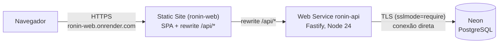

# Deploy no Render (plano gratuito) com PostgreSQL no Neon

Público: quem for publicar o Ronin no Render. Última revisão: 2026-09-17.

Este guia descreve o deploy de baixo custo: API como **Web Service** do Render (plano Free, Linux, região Virginia), front como **Static Site** do Render e banco no **Neon** (plano Free). O deploy em VPS com Caddy e Docker ([ADR 0009](../architecture/adr/0009-deploy-mesma-origem-caddy.md), Fatia 10) continua sendo a alternativa para produção com backup e sem hibernação.

## 1. Arquitetura



- **Mesma origem.** O navegador só fala com o Static Site. A regra de rewrite `/api/*` → `https://<ronin-api>.onrender.com/api/*` faz o Render buscar a resposta na API e devolvê-la na origem do Static Site. Assim valem, sem CORS: o cookie de sessão `__Host-kanban_sid` (`Secure`, sem `Domain`, `Path=/`), o `SameSite=Lax` e a checagem de CSRF por `Origin` igual a `APP_ORIGIN` ([`overview.md` §6.2 e §6.3](../architecture/overview.md#6-autenticação-sessão-e-csrf)).
- **`APP_ORIGIN` é a URL do Static Site** (ou do domínio próprio ligado a ele), não a URL da API.
- **A API também fica acessível direto** em `https://<ronin-api>.onrender.com`. Isso não abre a sessão (o cookie pertence à origem do Static Site) nem as mutações (o CSRF exige `Origin` igual a `APP_ORIGIN`), mas afeta o `TRUST_PROXY` (seção 7).
- **Banco no Neon** por conexão **direta** (host sem `-pooler`). A API mantém um pool pequeno (`DATABASE_POOL_MAX=5`), e as migrations usam `pg_advisory_lock` de sessão, que não é confiável atrás de um pooler em modo transação.

### Static Site do front (configurado no ronin-web)

Configuração esperada no Render, para referência de quem cuida do front:

| Campo | Valor |
| ----- | ----- |
| Rewrite 1 | origem `/api/*` → destino `https://<ronin-api>.onrender.com/api/*` |
| Rewrite 2 | origem `/*` → destino `/index.html` (fallback da SPA) |

A ordem importa: a regra de `/api/*` vem antes do fallback da SPA. Build, pasta publicada e headers (CSP, HSTS) ficam no guia de deploy do ronin-web.

## 2. Banco no Neon

1. Crie um projeto no Neon na região **AWS US East (N. Virginia)**, a mesma do Render, para reduzir latência.
2. Em _Connection details_, desligue **Connection pooling** e copie a string de conexão direta. Ela tem o formato:

   ```text
   postgresql://<usuário>:<senha>@ep-<nome>.us-east-1.aws.neon.tech/<banco>?sslmode=require
   ```

   Se vier `&channel_binding=require`, pode manter ou remover: o `pg` ignora esse parâmetro.
3. Não crie tabelas à mão: as migrations rodam em todo start da API (seção 5).

**TLS.** O `pg` monta o TLS a partir do `sslmode` da URL, sem `rejectUnauthorized: false`: com `sslmode=require`, o certificado do Neon (CA pública) é **verificado**, como em `verify-full`. Por isso, no primeiro connect aparece uma vez no log o aviso `SECURITY WARNING: The SSL modes 'prefer', 'require', and 'verify-ca' are treated as aliases for 'verify-full'`. Para silenciar e já ficar compatível com o `pg` 9, use `sslmode=verify-full` na URL: o comportamento é o mesmo. O teste `src/db/client.test.ts` trava que `require` continua verificando o certificado.

## 3. Variáveis de ambiente da API

Valores do [`render.yaml`](../../render.yaml). Os marcados como segredo (`sync: false`) são preenchidos no painel do Render e nunca vão para o repositório.

| Variável | Valor no Render | Notas |
| -------- | --------------- | ----- |
| `NODE_VERSION` | `24` | versão do Node usada no build e no runtime |
| `NODE_ENV` | `production` | liga cookie `Secure`/`__Host-`, desliga `/api/docs`, usa os parâmetros de produção do Argon2id e a limpeza periódica. Exige `APP_ORIGIN` em `https://` e `SETUP_TOKEN` |
| `HOST` | `0.0.0.0` | o padrão da API é `127.0.0.1`, que o Render não alcança |
| `PORT` | (injetada pelo Render) | não defina: a API lê a que o Render passar |
| `DATABASE_URL` | segredo | string direta do Neon com `?sslmode=require` (seção 2) |
| `SETUP_TOKEN` | segredo | código do setup inicial, 16 a 200 caracteres (seção 4) |
| `APP_ORIGIN` | segredo (`sync: false`) | origem do Static Site, ex.: `https://ronin-web.onrender.com`, sem barra final |
| `TRUST_PROXY` | `1` | número de saltos; leia a seção 7 antes de mudar |
| `DATABASE_POOL_MAX` | `5` | sugerido para o Neon Free (padrão da API: 10) |
| `LOG_LEVEL` | `info` | logs JSON (pino) no painel do Render |

Valores aceitos por `TRUST_PROXY` (validados na inicialização):

| Valor | Efeito |
| ----- | ------ |
| `false` | ignora `X-Forwarded-For`; `request.ip` é o endereço que conectou (padrão) |
| `true` | confia em qualquer um; `request.ip` vira o primeiro endereço do header, que o cliente forja. **Não use** |
| inteiro de 1 a 100 | confia nesse número de saltos a partir da conexão; `1` usa o último endereço do header, escrito pelo proxy que conectou na API |
| IPs/CIDRs separados por vírgula | confia só nesses proxies, ex.: `10.0.0.0/8,127.0.0.1` (aceita também `loopback`, `linklocal`, `uniquelocal`). É o formato certo quando o proxy tem IP fixo (Caddy na VPS) |

Se alguma variável estiver inválida, a API não sobe e o log do deploy mostra só o **nome** da variável e o motivo, nunca o valor.

## 4. Gerar o `SETUP_TOKEN`

Gere um código aleatório de 32 bytes em qualquer máquina com Node:

```powershell
node -e "console.log(require('node:crypto').randomBytes(32).toString('base64url'))"
```

O resultado tem 43 caracteres. Cole no campo `SETUP_TOKEN` do serviço no Render e guarde uma cópia num gerenciador de senhas: ele é pedido na tela de configuração inicial.

Por que existe: enquanto não há usuário, quem abrir a instância primeiro cria a equipe e vira Admin. Com `NODE_ENV=production` a API **não sobe** sem `SETUP_TOKEN`, e `POST /api/setup` sem o código certo responde `403 SETUP_TOKEN_INVALID` ([`api.md` §4 e §18.6](../architecture/api.md#186-código-de-configuração-do-setup-v110)). As tentativas contam no limite de 5 por 15 minutos por IP.

Depois do setup, o código não abre mais nada (o setup responde `409 SETUP_ALREADY_DONE`). Você pode trocá-lo por outro valor aleatório, mas não removê-lo: a variável continua obrigatória em produção.

## 5. Build, start e migrations

| Etapa | Comando | O que faz |
| ----- | ------- | --------- |
| Build | `corepack enable && pnpm install --frozen-lockfile && pnpm build` | ativa o pnpm da versão do `packageManager`, instala exatamente o lockfile (inclui as devDependencies, necessárias para o `tsup`) e gera `dist/server.js` e `dist/migrate.js` |
| Start | `pnpm start:prod` | `node dist/migrate.js && node --enable-source-maps dist/server.js` |
| Health check | `GET /api/health` | `200 { status: "ok", db: "ok" }`; `503` se o banco não responder em 3 s |

- `dist/migrate.js` aplica as migrations de `drizzle/` (relativo ao diretório atual, a raiz do repositório no Render; `MIGRATIONS_DIR` muda a pasta). É idempotente e usa advisory lock, então roda em todo start sem risco. Se falhar, o `&&` impede a API de subir e o deploy aparece como falho.
- Se o Render não encontrar o `pnpm` no start, use como start command o equivalente direto: `node dist/migrate.js && node --enable-source-maps dist/server.js`.
- A API trata `SIGTERM` (fecha conexões e o pool) quando o Render troca a instância no deploy.

## 6. Primeiro acesso

1. Faça o deploy da API e confira `https://<ronin-api>.onrender.com/api/health`.
2. Confira `https://<static-site>/api/health` pelo rewrite: a resposta deve ser a mesma.
3. Abra o Static Site. Com o banco vazio, aparece **Configurar a equipe**, que pede o **código de configuração** (`GET /api/setup/status` responde `requiresSetupToken: true`).
4. Informe nome da equipe, seu nome, e-mail, senha e o `SETUP_TOKEN`. A conta criada é Admin e já entra logada.
5. Convide o restante da equipe em **Administração → Convites**.

Faça o setup logo depois do primeiro deploy. Código errado responde "Código de configuração inválido.".

## 7. Limitação conhecida: `TRUST_PROXY` atrás do proxy do Render

O IP do cliente (`request.ip`) alimenta o bloqueio de login por IP (20 falhas em 15 min) e os limites por IP (setup, login, convites e redefinição, [`overview.md` §6.4](../architecture/overview.md#64-limites-de-tentativa)). No Render, a API nunca recebe a conexão direta do navegador: há ao menos o balanceador do Render e, no caminho do rewrite, também o proxy do Static Site. Esses proxies não têm IP fixo publicado, então a lista de IPs/CIDRs (a opção mais segura) não se aplica.

| Opção | `request.ip` | Risco |
| ----- | ------------ | ----- |
| `TRUST_PROXY=1` (padrão do `render.yaml`) | endereço que o balanceador do Render viu conectar. Pelo rewrite, tende a ser o IP de saída do proxy do Static Site, **compartilhado por todos os usuários** | não é forjável. Em compensação, os limites por IP passam a valer para a equipe inteira: 20 senhas erradas de quem quer que seja bloqueiam o login por IP de todos por 15 min, e 5 tentativas de setup esgotam o limite para todos |
| `TRUST_PROXY=2` | um salto a mais: o IP real do navegador, **se** o proxy do rewrite acrescentar o cliente ao `X-Forwarded-For` | quem chamar a URL `onrender.com` da API direto (um salto só) forja o IP com um `X-Forwarded-For` próprio e escapa dos limites por IP. O bloqueio por e-mail (5 falhas) continua valendo |
| `TRUST_PROXY=true` | primeiro endereço do header | forjável por qualquer um. Não use |
| `TRUST_PROXY=false` | IP interno do balanceador do Render | todos compartilham o mesmo IP, como no `1`, e sem ganho |

**Como confirmar depois do deploy.** Os logs de requisição trazem `req.remoteAddress` (o `request.ip` calculado). Faça login pelo Static Site de duas redes diferentes (ex.: Wi-Fi e 4G) e compare:

- endereços diferentes, iguais aos seus IPs públicos: o valor atual resolve o IP real;
- o mesmo endereço nas duas redes: é o IP de um proxy; os limites por IP estão compartilhados.

Não há como bloquear o acesso direto à URL `onrender.com` da API no plano Free, então a escolha é entre limite compartilhado (`1`) e limite contornável por quem chama a API direto (`2`). Para uma equipe pequena, o `1` é o padrão mais seguro; se os bloqueios compartilhados atrapalharem, avalie o `2` sabendo o risco, ou o deploy em VPS com Caddy e lista de IPs.

## 8. Limites do plano gratuito

**Render (Web Service Free)**

- **Hiberna após ~15 min sem requisições.** A próxima requisição acorda a instância, o que pode levar perto de um minuto (inclui rodar as migrations de novo). A primeira tela depois de um tempo parado demora; as seguintes, não.
- **750 horas de instância por mês por workspace**, somadas entre todos os Web Services Free do workspace. Com um só serviço que hiberna, sobra folga; com vários serviços acordados o mês inteiro, as horas acabam e os serviços ficam parados até o mês seguinte.
- Estado em memória some quando a instância hiberna ou reinicia: os contadores de rate limit por rota (`@fastify/rate-limit`) recomeçam do zero. O bloqueio de login fica no banco e não é afetado. A limpeza periódica (sessões vencidas, tokens antigos, bloqueios de login expirados e notificações lidas antigas) só roda com a instância acordada.
- Sem disco persistente: a API não grava arquivos; tudo fica no Neon.

**Neon (Free)**

- **0,5 GB de armazenamento** por projeto. Um workspace de equipe pequena cabe com folga, mas atividade e comentários crescem sem limpeza automática.
- O compute **suspende sozinho quando fica ocioso** e volta na próxima conexão, com alguns segundos de atraso. Se o banco demorar mais de 3 s para acordar, o `/api/health` pode responder `503` naquele momento; a requisição seguinte funciona. O pool da API espera até 5 s por conexão.
- Horas de compute e demais cotas mudam com o tempo: confira a página de preços do Neon.
- **Backup:** o plano Free tem janela curta de restauração (point-in-time). Para dados que importam, faça `pg_dump` periódico para fora do Neon.

## 9. Checklist

- [ ] Projeto Neon em US East, string **direta** com `sslmode=require` (ou `verify-full`)
- [ ] `SETUP_TOKEN` gerado e guardado fora do Render
- [ ] Web Service `ronin-api` com os valores do `render.yaml` e os segredos preenchidos
- [ ] `APP_ORIGIN` igual à URL do Static Site, em `https://`, sem barra final
- [ ] `/api/health` responde 200 na URL da API e pelo rewrite do Static Site
- [ ] Setup feito com o código; convites funcionando
- [ ] `req.remoteAddress` conferido nos logs (seção 7)
